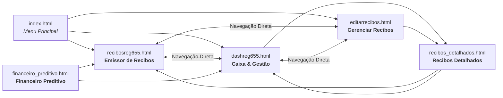
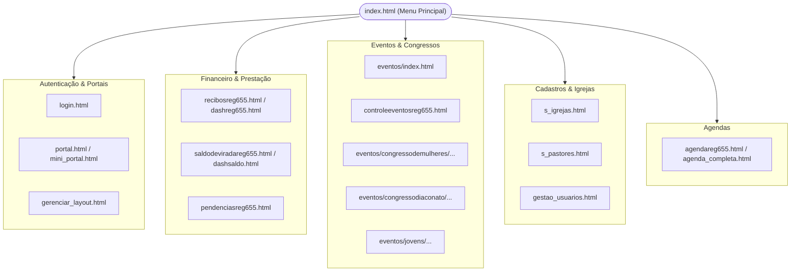
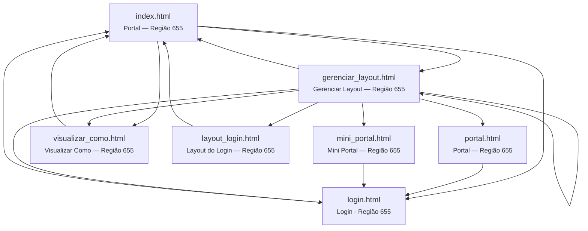
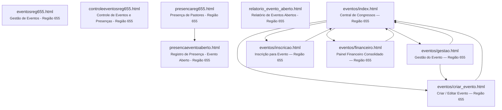
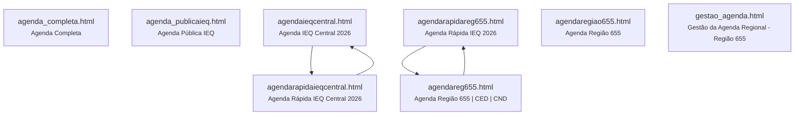
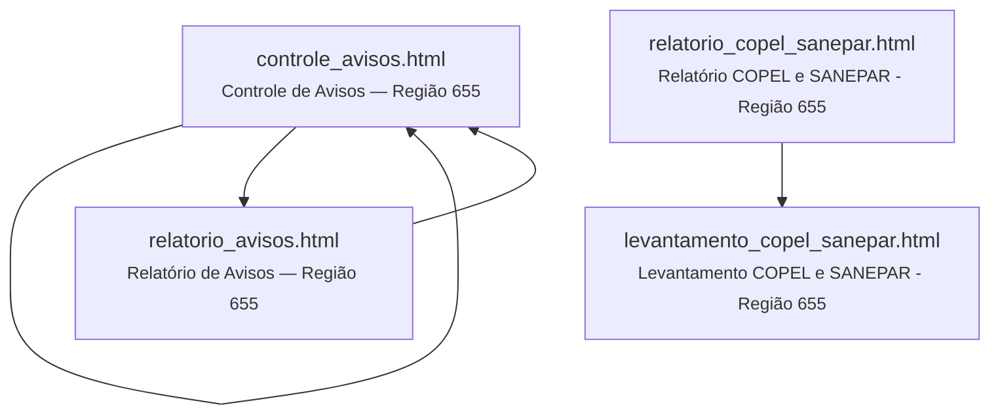
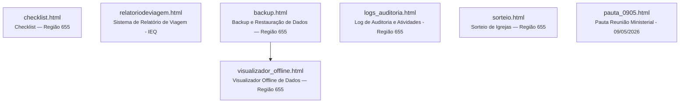

# Mapa Geral de Navegação e Relações entre Páginas HTML

> **Projeto:** AdmReg (Região 655)
> **Diretório Base:** `G:\Meu Drive\0Sinc\IA\AdmReg-main`
> **Total Mapeado:** 77 arquivos HTML (58 na raiz + 19 no módulo de Eventos)

## 1. Resumo Executivo da Estrutura

O ecossistema do AdmReg é composto por **77 páginas HTML interligadas** por links diretos (`<a href="...">`), redirecionamentos dinâmicos via JavaScript (`window.location`) e navegação em menus/botões. 

### Métricas Globais
| Indicador | Total | Descrição |
| :--- | :---: | :--- |
| **Total de Páginas HTML** | **77** | Todos os arquivos presentes no repositório e subpastas |
| **Páginas Raiz** | 58 | Telas centrais, financeiro, cadastros, relatórios e agenda |
| **Páginas de Eventos** | 19 | Gestão geral de eventos e congressos específicos (Mulheres, Diaconato, Jovens) |
| **Hub Central de Entrada** | `index.html` | Porta de entrada primária (recebe links de 37 páginas e aponta para 28 páginas) |
| **Hub Central de Configuração** | `gerenciar_layout.html` | Painel de controle de atalhos e cartões (aponta para 50+ ferramentas) |
| **Hub Financeiro** | `recibosreg655.html` / `dashreg655.html` | Tríade de emissão, listagem e edição de recibos e caixa |
| **Páginas Órfãs (0 inbound)** | **1** | `relatoriodeviagem.html` (não possui link apontando para ela a partir de outros HTMLs) |
| **Páginas Finais (0 outbound)** | **4** | `agenda_publicaieq.html`, `pauta_0905.html`, `relatoriodeviagem.html`, `s_contasreg655.html` |

---

## 2. Destaque Especial: Tríade de Recibos & Gestão Financeira

Conforme citado no seu exemplo, o módulo de recibos possui uma relação bidirecional densa e bem estruturada entre a **emissão**, a **dashboard/caixa** e a **edição de recibos**:

### Relação Detalhada das Páginas de Recibos:
- **`recibosreg655.html` (Emissor de Recibos):**
  - **Links de Saída (Aponta para):** `dashreg655.html`, `editarrecibos.html`, `index.html`
  - **Links de Entrada (Quem aponta para ela):** `dashreg655.html`, `editarrecibos.html`, `financeiro_preditivo.html`, `gerenciar_layout.html`, `index.html`, `recibos_detalhados.html`
- **`dashreg655.html` (Caixa Região 655):**
  - **Links de Saída:** `editarrecibos.html`, `index.html`, `recibos_detalhados.html`, `recibosreg655.html`
  - **Links de Entrada:** `editarrecibos.html`, `financeiro_preditivo.html`, `gerenciar_layout.html`, `index.html`, `recibos_detalhados.html`, `recibosreg655.html`
- **`editarrecibos.html` (Gerenciar Recibos):**
  - **Links de Saída:** `dashreg655.html`, `index.html`, `recibos_detalhados.html`, `recibosreg655.html`
  - **Links de Entrada:** `dashreg655.html`, `gerenciar_layout.html`, `index.html`, `recibos_detalhados.html`, `recibosreg655.html`

---

## 3. Visão Macroscópica da Arquitetura (Módulos do Sistema)

---

## 4. Mapeamento Completo por Módulos Funcionais

### 4.1 Módulo: Painéis Principais & Autenticação

| Arquivo | Título da Página | Links de Saída (Aponta para) | Links de Entrada (Quem aponta para ela) |
| :--- | :--- | :--- | :--- |
| `gerenciar_layout.html` | **Gerenciar Layout — Região 655** | `agenda_completa.html` `agenda_publicaieq.html` `agendaieqcentral.html` `agendarapidaieqcentral.html` `agendarapidareg655.html` `agendareg655.html` `agendaregiao655.html` `backup.html` `checklist.html` `controle_avisos.html` `controleeventosreg655.html` `coordenadorias.html` `dashreg655.html` `dashsaldo.html` `debitos_manuais.html` `devolucao_9018.html` `editar_mini_portal.html` `editarrecibos.html` `editpagmembros.html` `editpagpastores.html` `eventos/index.html` `eventosreg655.html` `financeiro_preditivo.html` `gerenciar_layout.html` `gerenciar_saldos.html` `gestao_agenda.html` `gestao_seminarios.html` `gestao_usuarios.html` `index.html` `layout_login.html` `login.html` `mini_portal.html` `pauta_0905.html` `pendenciasreg655.html` `portal.html` `presencareg655.html` `recibos_detalhados.html` `recibosreg655.html` `relatorio_avisos.html` `relatorio_pendencias.html` `s_contasreg655.html` `s_coordenadores_cidadania.html` `s_igrejas.html` `s_pastores.html` `saldodeviradareg655.html` `sorteio.html` `visualizar_como.html` | `gerenciar_layout.html` `index.html` |
| `index.html` | **Portal — Região 655** | `agendarapidareg655.html` `agendareg655.html` `backup.html` `controle_avisos.html` `controleeventosreg655.html` `coordenadorias.html` `dashreg655.html` `dashsaldo.html` `editarrecibos.html` `editpagpastores.html` `eventos/index.html` `eventosreg655.html` `financeiro_preditivo.html` `gerenciar_layout.html` `gerenciar_saldos.html` `gestao_usuarios.html` `levantamento_copel_sanepar.html` `login.html` `logs_auditoria.html` `pendenciasreg655.html` `presencaeventoaberto.html` `presencareg655.html` `recibos_detalhados.html` `recibosreg655.html` `relatorio_avisos.html` `relatorio_copel_sanepar.html` `relatorio_evento_aberto.html` `relatorio_pendencias.html` `s_igrejas.html` `s_pastores.html` `saldodeviradareg655.html` `visualizar_como.html` | `agenda_completa.html` `agendarapidaieqcentral.html` `agendarapidareg655.html` `agendaregiao655.html` `backup.html` `checklist.html` `controle_avisos.html` `controleeventosreg655.html` `coordenadorias.html` `dashreg655.html` `dashsaldo.html` `debitos_manuais.html` `devolucao_9018.html` `editar_mini_portal.html` `editarrecibos.html` `editpagmembros.html` `editpagpastores.html` `eventos/index.html` `eventosreg655.html` `financeiro_preditivo.html` `francamaster.html` `francapastores.html` `gerenciar_layout.html` `gerenciar_saldos.html` `gestao_agenda.html` `gestao_seminarios.html` `gestao_usuarios.html` `layout_login.html` `levantamento_copel_sanepar.html` `login.html` `logs_auditoria.html` `pendenciascontabeismaster.html` `pendenciascontabeispastores.html` `pendenciasreg655.html` `presencaeventoaberto.html` `presencareg655.html` `recibos_detalhados.html` `recibosreg655.html` `relatorio_avisos.html` `relatorio_copel_sanepar.html` `relatorio_evento_aberto.html` `relatorio_pendencias.html` `resumo_seminarios.html` `s_coordenadores_cidadania.html` `s_igrejas.html` `s_pastores.html` `saldodeviradareg655.html` `sorteio.html` `visualizador_offline.html` `visualizar_como.html` |
| `layout_login.html` | **Layout do Login — Região 655** | `agendaregiao655.html` `index.html` `presencareg655.html` | `gerenciar_layout.html` |
| `login.html` | **Login - Região 655** | `agendaregiao655.html` `index.html` `presencareg655.html` | `editar_mini_portal.html` `eventos/criar_evento.html` `gerenciar_layout.html` `gestao_agenda.html` `index.html` `mini_portal.html` `portal.html` |
| `mini_portal.html` | **Mini Portal — Região 655** | `agenda_completa.html` `gestao_agenda.html` `login.html` `pauta_0905.html` `presencareg655.html` `s_contasreg655.html` `sorteio.html` | `editar_mini_portal.html` `gerenciar_layout.html` |
| `portal.html` | **Portal — Região 655** | `login.html` | `editpagmembros.html` `gerenciar_layout.html` |
| `visualizar_como.html` | **Visualizar Como — Região 655** | `index.html` | `gerenciar_layout.html` `index.html` |

---

### 4.2 Módulo: Financeiro & Recibos

```mermaid
flowchart TD
    recibosreg655_html["recibosreg655.html<br/><small>Emissor de Recibos - Região 655</small>"]
    editarrecibos_html["editarrecibos.html<br/><small>Gerenciar Recibos - Região 655</small>"]
    recibos_detalhados_html["recibos_detalhados.html<br/><small>Detalhamento de Recibos - Região 655</small>"]
    dashreg655_html["dashreg655.html<br/><small>Caixa Região 655 - Gestão de Igrejas</small>"]
    saldodeviradareg655_html["saldodeviradareg655.html<br/><small>Virada de Mês - Admin - R655</small>"]
    gerenciar_saldos_html["gerenciar_saldos.html<br/><small>Gerenciar Saldos - Região 655</small>"]
    dashsaldo_html["dashsaldo.html<br/><small>Dashboard Financeiro - Igrejas</small>"]
    debitos_manuais_html["debitos_manuais.html<br/><small>Débitos Manuais — Região 655</small>"]
    pendenciasreg655_html["pendenciasreg655.html<br/><small>Pendências Rápidas - Região 655</small>"]
    relatorio_pendencias_html["relatorio_pendencias.html<br/><small>Relatório de Pendências - Região 655</small>"]
    pendenciascontabeismaster_html["pendenciascontabeismaster.html<br/><small>Gerenciar Pendências Contábeis — Região 655</small>"]
    pendenciascontabeispastores_html["pendenciascontabeispastores.html<br/><small>Minhas Pendências Contábeis — Região 655</small>"]
    financeiro_preditivo_html["financeiro_preditivo.html<br/><small>Financeiro Preditivo — Região 655</small>"]
    devolucao_9018_html["devolucao_9018.html<br/><small>Devolução 9018 — Região 655</small>"]
    francamaster_html["francamaster.html<br/><small>Painel Master França — Região 655</small>"]
    francapastores_html["francapastores.html<br/><small>Oferta para a França — Região 655</small>"]
    s_contasreg655_html["s_contasreg655.html<br/><small>Contas Correntes - Região 655</small>"]
    recibosreg655_html --> dashreg655_html
    recibosreg655_html --> editarrecibos_html
    editarrecibos_html --> dashreg655_html
    editarrecibos_html --> recibos_detalhados_html
    editarrecibos_html --> recibosreg655_html
    recibos_detalhados_html --> dashreg655_html
    recibos_detalhados_html --> editarrecibos_html
    recibos_detalhados_html --> recibos_detalhados_html
    recibos_detalhados_html --> recibosreg655_html
    dashreg655_html --> editarrecibos_html
    dashreg655_html --> recibos_detalhados_html
    dashreg655_html --> recibosreg655_html
    debitos_manuais_html --> pendenciasreg655_html
    pendenciasreg655_html --> debitos_manuais_html
    pendenciascontabeismaster_html --> pendenciascontabeispastores_html
    pendenciascontabeispastores_html --> pendenciascontabeismaster_html
    financeiro_preditivo_html --> dashreg655_html
    financeiro_preditivo_html --> recibosreg655_html
    francamaster_html --> francapastores_html
    francapastores_html --> francamaster_html
```

| Arquivo | Título da Página | Links de Saída (Aponta para) | Links de Entrada (Quem aponta para ela) |
| :--- | :--- | :--- | :--- |
| `dashreg655.html` | **Caixa Região 655 - Gestão de Igrejas** | `editarrecibos.html` `index.html` `recibos_detalhados.html` `recibosreg655.html` | `editarrecibos.html` `financeiro_preditivo.html` `gerenciar_layout.html` `index.html` `recibos_detalhados.html` `recibosreg655.html` |
| `dashsaldo.html` | **Dashboard Financeiro - Igrejas** | `index.html` | `gerenciar_layout.html` `index.html` |
| `debitos_manuais.html` | **Débitos Manuais — Região 655** | `index.html` `pendenciasreg655.html` | `gerenciar_layout.html` `pendenciasreg655.html` |
| `devolucao_9018.html` | **Devolução 9018 — Região 655** | `index.html` | `gerenciar_layout.html` |
| `editarrecibos.html` | **Gerenciar Recibos - Região 655** | `dashreg655.html` `index.html` `recibos_detalhados.html` `recibosreg655.html` | `dashreg655.html` `gerenciar_layout.html` `index.html` `recibos_detalhados.html` `recibosreg655.html` |
| `financeiro_preditivo.html` | **Financeiro Preditivo — Região 655** | `dashreg655.html` `index.html` `recibosreg655.html` | `gerenciar_layout.html` `index.html` |
| `francamaster.html` | **Painel Master França — Região 655** | `francapastores.html` `index.html` | `francapastores.html` |
| `francapastores.html` | **Oferta para a França — Região 655** | `francamaster.html` `index.html` | `francamaster.html` |
| `gerenciar_saldos.html` | **Gerenciar Saldos - Região 655** | `index.html` | `gerenciar_layout.html` `index.html` |
| `pendenciascontabeismaster.html` | **Gerenciar Pendências Contábeis — Região 655** | `index.html` `pendenciascontabeispastores.html` | `pendenciascontabeispastores.html` |
| `pendenciascontabeispastores.html` | **Minhas Pendências Contábeis — Região 655** | `index.html` `pendenciascontabeismaster.html` | `pendenciascontabeismaster.html` |
| `pendenciasreg655.html` | **Pendências Rápidas - Região 655** | `debitos_manuais.html` `index.html` | `debitos_manuais.html` `gerenciar_layout.html` `index.html` |
| `recibos_detalhados.html` | **Detalhamento de Recibos - Região 655** | `dashreg655.html` `editarrecibos.html` `index.html` `recibos_detalhados.html` `recibosreg655.html` | `dashreg655.html` `editarrecibos.html` `gerenciar_layout.html` `index.html` `recibos_detalhados.html` |
| `recibosreg655.html` | **Emissor de Recibos - Região 655** | `dashreg655.html` `editarrecibos.html` `index.html` | `dashreg655.html` `editarrecibos.html` `financeiro_preditivo.html` `gerenciar_layout.html` `index.html` `recibos_detalhados.html` |
| `relatorio_pendencias.html` | **Relatório de Pendências - Região 655** | `index.html` | `gerenciar_layout.html` `index.html` |
| `s_contasreg655.html` | **Contas Correntes - Região 655** | *Nenhum (página terminal)* | `editar_mini_portal.html` `gerenciar_layout.html` `mini_portal.html` |
| `saldodeviradareg655.html` | **Virada de Mês - Admin - R655** | `index.html` | `gerenciar_layout.html` `index.html` |

---

### 4.3 Módulo: Eventos & Presenças (Geral)

| Arquivo | Título da Página | Links de Saída (Aponta para) | Links de Entrada (Quem aponta para ela) |
| :--- | :--- | :--- | :--- |
| `controleeventosreg655.html` | **Controle de Eventos e Presenças - Região 655** | `index.html` | `gerenciar_layout.html` `index.html` |
| `eventos/criar_evento.html` | **Criar / Editar Evento — Região 655** | `eventos/index.html` `login.html` | `eventos/gestao.html` `eventos/index.html` |
| `eventos/financeiro.html` | **Painel Financeiro Consolidado — Região 655** | `eventos/index.html` | `eventos/index.html` |
| `eventos/gestao.html` | **Gestão do Evento — Região 655** | `eventos/criar_evento.html` `eventos/index.html` | `eventos/index.html` |
| `eventos/index.html` | **Central de Congressos — Região 655** | `eventos/congressodemulheres/index.html` `eventos/congressodiaconato/index.html` `eventos/criar_evento.html` `eventos/financeiro.html` `eventos/gestao.html` `eventos/inscricao.html` `eventos/jovens/index.html` `index.html` | `eventos/criar_evento.html` `eventos/financeiro.html` `eventos/gestao.html` `eventos/inscricao.html` `gerenciar_layout.html` `index.html` |
| `eventos/inscricao.html` | **Inscrição para Evento — Região 655** | `eventos/index.html` | `eventos/index.html` |
| `eventosreg655.html` | **Gestão de Eventos - Região 655** | `index.html` | `gerenciar_layout.html` `index.html` |
| `presencaeventoaberto.html` | **Registro de Presença - Evento Aberto - Região 655** | `index.html` | `index.html` `presencareg655.html` |
| `presencareg655.html` | **Presença de Pastores - Região 655** | `index.html` `presencaeventoaberto.html` | `editar_mini_portal.html` `gerenciar_layout.html` `index.html` `layout_login.html` `login.html` `mini_portal.html` |
| `relatorio_evento_aberto.html` | **Relatório de Eventos Abertos - Região 655** | `index.html` | `index.html` |

---

### 4.4 Módulo: Eventos Específicos (Congressos)

```mermaid
flowchart TD
    eventos_congressodemulheres_igrejas_html["eventos/congressodemulheres/igrejas.html<br/><small>Igrejas — Congresso de Mulheres</small>"]
    eventos_congressodemulheres_index_html["eventos/congressodemulheres/index.html<br/><small>Congresso de Mulheres — IEQ Região 655</small>"]
    eventos_congressodemulheres_inscricoes_html["eventos/congressodemulheres/inscricoes.html<br/><small>Inscrições — Congresso de Mulheres</small>"]
    eventos_congressodemulheres_manual_html["eventos/congressodemulheres/manual.html<br/><small>Manual — Congresso de Mulheres</small>"]
    eventos_congressodemulheres_pagamentos_html["eventos/congressodemulheres/pagamentos.html<br/><small>Pagamentos — Congresso de Mulheres</small>"]
    eventos_congressodemulheres_relatorios_html["eventos/congressodemulheres/relatorios.html<br/><small>Relatórios — Congresso de Mulheres</small>"]
    eventos_congressodiaconato_igrejas_html["eventos/congressodiaconato/igrejas.html<br/><small>Igrejas — Congresso do Diaconato</small>"]
    eventos_congressodiaconato_index_html["eventos/congressodiaconato/index.html<br/><small>Congresso do Diaconato — IEQ Região 655</small>"]
    eventos_congressodiaconato_inscricoes_html["eventos/congressodiaconato/inscricoes.html<br/><small>Inscrições — Congresso do Diaconato</small>"]
    eventos_congressodiaconato_manual_html["eventos/congressodiaconato/manual.html<br/><small>Manual — Congresso do Diaconato</small>"]
    eventos_congressodiaconato_pagamentos_html["eventos/congressodiaconato/pagamentos.html<br/><small>Pagamentos — Congresso do Diaconato</small>"]
    eventos_congressodiaconato_relatorios_html["eventos/congressodiaconato/relatorios.html<br/><small>Relatórios — Congresso do Diaconato</small>"]
    eventos_jovens_index_html["eventos/jovens/index.html<br/><small>Painel — Congresso de Jovens</small>"]
    eventos_jovens_inscricoes_html["eventos/jovens/inscricoes.html<br/><small>Inscrições — Congresso de Jovens</small>"]
    eventos_congressodemulheres_igrejas_html --> eventos_congressodemulheres_index_html
    eventos_congressodemulheres_index_html --> eventos_congressodemulheres_igrejas_html
    eventos_congressodemulheres_index_html --> eventos_congressodemulheres_inscricoes_html
    eventos_congressodemulheres_index_html --> eventos_congressodemulheres_manual_html
    eventos_congressodemulheres_index_html --> eventos_congressodemulheres_pagamentos_html
    eventos_congressodemulheres_index_html --> eventos_congressodemulheres_relatorios_html
    eventos_congressodemulheres_inscricoes_html --> eventos_congressodemulheres_igrejas_html
    eventos_congressodemulheres_inscricoes_html --> eventos_congressodemulheres_index_html
    eventos_congressodemulheres_manual_html --> eventos_congressodemulheres_index_html
    eventos_congressodemulheres_pagamentos_html --> eventos_congressodemulheres_igrejas_html
    eventos_congressodemulheres_pagamentos_html --> eventos_congressodemulheres_index_html
    eventos_congressodemulheres_relatorios_html --> eventos_congressodemulheres_index_html
    eventos_congressodiaconato_igrejas_html --> eventos_congressodiaconato_index_html
    eventos_congressodiaconato_index_html --> eventos_congressodiaconato_igrejas_html
    eventos_congressodiaconato_index_html --> eventos_congressodiaconato_inscricoes_html
    eventos_congressodiaconato_index_html --> eventos_congressodiaconato_manual_html
    eventos_congressodiaconato_index_html --> eventos_congressodiaconato_pagamentos_html
    eventos_congressodiaconato_index_html --> eventos_congressodiaconato_relatorios_html
    eventos_congressodiaconato_inscricoes_html --> eventos_congressodiaconato_igrejas_html
    eventos_congressodiaconato_inscricoes_html --> eventos_congressodiaconato_index_html
    eventos_congressodiaconato_manual_html --> eventos_congressodiaconato_index_html
    eventos_congressodiaconato_pagamentos_html --> eventos_congressodiaconato_igrejas_html
    eventos_congressodiaconato_pagamentos_html --> eventos_congressodiaconato_index_html
    eventos_congressodiaconato_relatorios_html --> eventos_congressodiaconato_index_html
    eventos_jovens_index_html --> eventos_jovens_inscricoes_html
    eventos_jovens_inscricoes_html --> eventos_jovens_index_html
```

| Arquivo | Título da Página | Links de Saída (Aponta para) | Links de Entrada (Quem aponta para ela) |
| :--- | :--- | :--- | :--- |
| `eventos/congressodemulheres/igrejas.html` | **Igrejas — Congresso de Mulheres** | `eventos/congressodemulheres/index.html` | `eventos/congressodemulheres/index.html` `eventos/congressodemulheres/inscricoes.html` `eventos/congressodemulheres/pagamentos.html` |
| `eventos/congressodemulheres/index.html` | **Congresso de Mulheres — IEQ Região 655** | `eventos/congressodemulheres/igrejas.html` `eventos/congressodemulheres/inscricoes.html` `eventos/congressodemulheres/manual.html` `eventos/congressodemulheres/pagamentos.html` `eventos/congressodemulheres/relatorios.html` | `eventos/congressodemulheres/igrejas.html` `eventos/congressodemulheres/inscricoes.html` `eventos/congressodemulheres/manual.html` `eventos/congressodemulheres/pagamentos.html` `eventos/congressodemulheres/relatorios.html` `eventos/index.html` |
| `eventos/congressodemulheres/inscricoes.html` | **Inscrições — Congresso de Mulheres** | `eventos/congressodemulheres/igrejas.html` `eventos/congressodemulheres/index.html` | `eventos/congressodemulheres/index.html` |
| `eventos/congressodemulheres/manual.html` | **Manual — Congresso de Mulheres** | `eventos/congressodemulheres/index.html` | `eventos/congressodemulheres/index.html` |
| `eventos/congressodemulheres/pagamentos.html` | **Pagamentos — Congresso de Mulheres** | `eventos/congressodemulheres/igrejas.html` `eventos/congressodemulheres/index.html` | `eventos/congressodemulheres/index.html` |
| `eventos/congressodemulheres/relatorios.html` | **Relatórios — Congresso de Mulheres** | `eventos/congressodemulheres/index.html` | `eventos/congressodemulheres/index.html` |
| `eventos/congressodiaconato/igrejas.html` | **Igrejas — Congresso do Diaconato** | `eventos/congressodiaconato/index.html` | `eventos/congressodiaconato/index.html` `eventos/congressodiaconato/inscricoes.html` `eventos/congressodiaconato/pagamentos.html` |
| `eventos/congressodiaconato/index.html` | **Congresso do Diaconato — IEQ Região 655** | `eventos/congressodiaconato/igrejas.html` `eventos/congressodiaconato/inscricoes.html` `eventos/congressodiaconato/manual.html` `eventos/congressodiaconato/pagamentos.html` `eventos/congressodiaconato/relatorios.html` | `eventos/congressodiaconato/igrejas.html` `eventos/congressodiaconato/inscricoes.html` `eventos/congressodiaconato/manual.html` `eventos/congressodiaconato/pagamentos.html` `eventos/congressodiaconato/relatorios.html` `eventos/index.html` |
| `eventos/congressodiaconato/inscricoes.html` | **Inscrições — Congresso do Diaconato** | `eventos/congressodiaconato/igrejas.html` `eventos/congressodiaconato/index.html` | `eventos/congressodiaconato/index.html` |
| `eventos/congressodiaconato/manual.html` | **Manual — Congresso do Diaconato** | `eventos/congressodiaconato/index.html` | `eventos/congressodiaconato/index.html` |
| `eventos/congressodiaconato/pagamentos.html` | **Pagamentos — Congresso do Diaconato** | `eventos/congressodiaconato/igrejas.html` `eventos/congressodiaconato/index.html` | `eventos/congressodiaconato/index.html` |
| `eventos/congressodiaconato/relatorios.html` | **Relatórios — Congresso do Diaconato** | `eventos/congressodiaconato/index.html` | `eventos/congressodiaconato/index.html` |
| `eventos/jovens/index.html` | **Painel — Congresso de Jovens** | `eventos/jovens/inscricoes.html` | `eventos/index.html` `eventos/jovens/inscricoes.html` |
| `eventos/jovens/inscricoes.html` | **Inscrições — Congresso de Jovens** | `eventos/jovens/index.html` | `eventos/jovens/index.html` |

---

### 4.5 Módulo: Agenda

| Arquivo | Título da Página | Links de Saída (Aponta para) | Links de Entrada (Quem aponta para ela) |
| :--- | :--- | :--- | :--- |
| `agenda_completa.html` | **Agenda Completa** | `index.html` | `editar_mini_portal.html` `gerenciar_layout.html` `mini_portal.html` |
| `agenda_publicaieq.html` | **Agenda Pública IEQ** | *Nenhum (página terminal)* | `gerenciar_layout.html` |
| `agendaieqcentral.html` | **Agenda IEQ Central 2026** | `agendarapidaieqcentral.html` | `agendarapidaieqcentral.html` `gerenciar_layout.html` |
| `agendarapidaieqcentral.html` | **Agenda Rápida IEQ Central 2026** | `agendaieqcentral.html` `index.html` | `agendaieqcentral.html` `gerenciar_layout.html` |
| `agendarapidareg655.html` | **Agenda Rápida IEQ 2026** | `agendareg655.html` `index.html` | `agendareg655.html` `gerenciar_layout.html` `index.html` |
| `agendareg655.html` | **Agenda Região 655 | CED | CND** | `agendarapidareg655.html` | `agendarapidareg655.html` `gerenciar_layout.html` `index.html` |
| `agendaregiao655.html` | **Agenda Região 655** | `index.html` | `gerenciar_layout.html` `layout_login.html` `login.html` |
| `gestao_agenda.html` | **Gestão da Agenda Regional - Região 655** | `index.html` `login.html` | `editar_mini_portal.html` `gerenciar_layout.html` `mini_portal.html` |

---

### 4.6 Módulo: Cadastros & Gestão

```mermaid
flowchart TD
    s_igrejas_html["s_igrejas.html<br/><small>Igrejas - Região 655</small>"]
    s_pastores_html["s_pastores.html<br/><small>Pastores - Região 655</small>"]
    coordenadorias_html["coordenadorias.html<br/><small>Coordenadorias - Região 655</small>"]
    gestao_usuarios_html["gestao_usuarios.html<br/><small>Gestão de Usuários e Acessos - Região 655</small>"]
    gestao_seminarios_html["gestao_seminarios.html<br/><small>Gestão de Seminários - Região 655</small>"]
    resumo_seminarios_html["resumo_seminarios.html<br/><small>Resumo dos Seminários - Região 655</small>"]
    s_coordenadores_cidadania_html["s_coordenadores_cidadania.html<br/><small>Coordenadores de Cidadania - Região 655</small>"]
    editpagpastores_html["editpagpastores.html<br/><small>Editar Painel dos Pastores - Região 655</small>"]
    editpagmembros_html["editpagmembros.html<br/><small>Gestão do Portal Público Membros - Região 655</small>"]
    editar_mini_portal_html["editar_mini_portal.html<br/><small>Editar Mini Portal — Região 655</small>"]
    gestao_seminarios_html --> resumo_seminarios_html
    gestao_seminarios_html --> s_coordenadores_cidadania_html
    resumo_seminarios_html --> gestao_seminarios_html
    s_coordenadores_cidadania_html --> gestao_seminarios_html
```

| Arquivo | Título da Página | Links de Saída (Aponta para) | Links de Entrada (Quem aponta para ela) |
| :--- | :--- | :--- | :--- |
| `coordenadorias.html` | **Coordenadorias - Região 655** | `index.html` | `gerenciar_layout.html` `index.html` |
| `editar_mini_portal.html` | **Editar Mini Portal — Região 655** | `agenda_completa.html` `gestao_agenda.html` `index.html` `login.html` `mini_portal.html` `pauta_0905.html` `presencareg655.html` `s_contasreg655.html` `sorteio.html` | `gerenciar_layout.html` |
| `editpagmembros.html` | **Gestão do Portal Público (Membros) - Região 655** | `index.html` `portal.html` | `gerenciar_layout.html` |
| `editpagpastores.html` | **Editar Painel dos Pastores - Região 655** | `controle_avisos.html` `index.html` | `controle_avisos.html` `gerenciar_layout.html` `index.html` |
| `gestao_seminarios.html` | **Gestão de Seminários - Região 655** | `index.html` `resumo_seminarios.html` `s_coordenadores_cidadania.html` | `gerenciar_layout.html` `resumo_seminarios.html` `s_coordenadores_cidadania.html` |
| `gestao_usuarios.html` | **Gestão de Usuários e Acessos - Região 655** | `backup.html` `index.html` | `gerenciar_layout.html` `index.html` |
| `resumo_seminarios.html` | **Resumo dos Seminários - Região 655** | `gestao_seminarios.html` `index.html` | `gestao_seminarios.html` |
| `s_coordenadores_cidadania.html` | **Coordenadores de Cidadania - Região 655** | `gestao_seminarios.html` `index.html` | `gerenciar_layout.html` `gestao_seminarios.html` |
| `s_igrejas.html` | **Igrejas - Região 655** | `index.html` | `gerenciar_layout.html` `index.html` |
| `s_pastores.html` | **Pastores - Região 655** | `index.html` | `gerenciar_layout.html` `index.html` |

---

### 4.7 Módulo: Comunicação & Levantamentos

| Arquivo | Título da Página | Links de Saída (Aponta para) | Links de Entrada (Quem aponta para ela) |
| :--- | :--- | :--- | :--- |
| `controle_avisos.html` | **Controle de Avisos — Região 655** | `controle_avisos.html` `editpagpastores.html` `index.html` `relatorio_avisos.html` | `controle_avisos.html` `editpagpastores.html` `gerenciar_layout.html` `index.html` `relatorio_avisos.html` |
| `levantamento_copel_sanepar.html` | **Levantamento COPEL e SANEPAR - Região 655** | `index.html` | `index.html` `relatorio_copel_sanepar.html` |
| `relatorio_avisos.html` | **Relatório de Avisos — Região 655** | `controle_avisos.html` `index.html` | `controle_avisos.html` `gerenciar_layout.html` `index.html` |
| `relatorio_copel_sanepar.html` | **Relatório COPEL e SANEPAR - Região 655** | `index.html` `levantamento_copel_sanepar.html` | `index.html` |

---

### 4.8 Módulo: Operacional, Segurança & Utilitários

| Arquivo | Título da Página | Links de Saída (Aponta para) | Links de Entrada (Quem aponta para ela) |
| :--- | :--- | :--- | :--- |
| `backup.html` | **Backup e Restauração de Dados — Região 655** | `index.html` `visualizador_offline.html` | `gerenciar_layout.html` `gestao_usuarios.html` `index.html` |
| `checklist.html` | **Checklist — Região 655** | `index.html` | `gerenciar_layout.html` |
| `logs_auditoria.html` | **Log de Auditoria e Atividades - Região 655** | `index.html` | `index.html` |
| `pauta_0905.html` | **Pauta Reunião Ministerial - 09/05/2026** | *Nenhum (página terminal)* | `editar_mini_portal.html` `gerenciar_layout.html` `mini_portal.html` |
| `relatoriodeviagem.html` | **Sistema de Relatório de Viagem - IEQ** | *Nenhum (página terminal)* | ⚠️ **Nenhum (órfã)** |
| `sorteio.html` | **Sorteio de Igrejas — Região 655** | `index.html` | `editar_mini_portal.html` `gerenciar_layout.html` `mini_portal.html` |
| `visualizador_offline.html` | **Visualizador Offline de Dados — Região 655** | `index.html` | `backup.html` |

---

## 5. Tabela Completa Alfabética (Índice de Todas as 77 Páginas)

| # | Arquivo HTML | Título | Saídas (Out) | Entradas (In) |
| :---: | :--- | :--- | :---: | :---: |
| 1 | `agenda_completa.html` | Agenda Completa | 1 | 3 |
| 2 | `agenda_publicaieq.html` | Agenda Pública IEQ | 0 | 1 |
| 3 | `agendaieqcentral.html` | Agenda IEQ Central 2026 | 1 | 2 |
| 4 | `agendarapidaieqcentral.html` | Agenda Rápida IEQ Central 2026 | 2 | 2 |
| 5 | `agendarapidareg655.html` | Agenda Rápida IEQ 2026 | 2 | 3 |
| 6 | `agendareg655.html` | Agenda Região 655 | CED | CND | 1 | 3 |
| 7 | `agendaregiao655.html` | Agenda Região 655 | 1 | 3 |
| 8 | `backup.html` | Backup e Restauração de Dados — Região 655 | 2 | 3 |
| 9 | `checklist.html` | Checklist — Região 655 | 1 | 1 |
| 10 | `controle_avisos.html` | Controle de Avisos — Região 655 | 4 | 5 |
| 11 | `controleeventosreg655.html` | Controle de Eventos e Presenças - Região 655 | 1 | 2 |
| 12 | `coordenadorias.html` | Coordenadorias - Região 655 | 1 | 2 |
| 13 | `dashreg655.html` | Caixa Região 655 - Gestão de Igrejas | 4 | 6 |
| 14 | `dashsaldo.html` | Dashboard Financeiro - Igrejas | 1 | 2 |
| 15 | `debitos_manuais.html` | Débitos Manuais — Região 655 | 2 | 2 |
| 16 | `devolucao_9018.html` | Devolução 9018 — Região 655 | 1 | 1 |
| 17 | `editar_mini_portal.html` | Editar Mini Portal — Região 655 | 9 | 1 |
| 18 | `editarrecibos.html` | Gerenciar Recibos - Região 655 | 4 | 5 |
| 19 | `editpagmembros.html` | Gestão do Portal Público (Membros) - Região 655 | 2 | 1 |
| 20 | `editpagpastores.html` | Editar Painel dos Pastores - Região 655 | 2 | 3 |
| 21 | `eventos/congressodemulheres/igrejas.html` | Igrejas — Congresso de Mulheres | 1 | 3 |
| 22 | `eventos/congressodemulheres/index.html` | Congresso de Mulheres — IEQ Região 655 | 5 | 6 |
| 23 | `eventos/congressodemulheres/inscricoes.html` | Inscrições — Congresso de Mulheres | 2 | 1 |
| 24 | `eventos/congressodemulheres/manual.html` | Manual — Congresso de Mulheres | 1 | 1 |
| 25 | `eventos/congressodemulheres/pagamentos.html` | Pagamentos — Congresso de Mulheres | 2 | 1 |
| 26 | `eventos/congressodemulheres/relatorios.html` | Relatórios — Congresso de Mulheres | 1 | 1 |
| 27 | `eventos/congressodiaconato/igrejas.html` | Igrejas — Congresso do Diaconato | 1 | 3 |
| 28 | `eventos/congressodiaconato/index.html` | Congresso do Diaconato — IEQ Região 655 | 5 | 6 |
| 29 | `eventos/congressodiaconato/inscricoes.html` | Inscrições — Congresso do Diaconato | 2 | 1 |
| 30 | `eventos/congressodiaconato/manual.html` | Manual — Congresso do Diaconato | 1 | 1 |
| 31 | `eventos/congressodiaconato/pagamentos.html` | Pagamentos — Congresso do Diaconato | 2 | 1 |
| 32 | `eventos/congressodiaconato/relatorios.html` | Relatórios — Congresso do Diaconato | 1 | 1 |
| 33 | `eventos/criar_evento.html` | Criar / Editar Evento — Região 655 | 2 | 2 |
| 34 | `eventos/financeiro.html` | Painel Financeiro Consolidado — Região 655 | 1 | 1 |
| 35 | `eventos/gestao.html` | Gestão do Evento — Região 655 | 2 | 1 |
| 36 | `eventos/index.html` | Central de Congressos — Região 655 | 8 | 6 |
| 37 | `eventos/inscricao.html` | Inscrição para Evento — Região 655 | 1 | 1 |
| 38 | `eventos/jovens/index.html` | Painel — Congresso de Jovens | 1 | 2 |
| 39 | `eventos/jovens/inscricoes.html` | Inscrições — Congresso de Jovens | 1 | 1 |
| 40 | `eventosreg655.html` | Gestão de Eventos - Região 655 | 1 | 2 |
| 41 | `financeiro_preditivo.html` | Financeiro Preditivo — Região 655 | 3 | 2 |
| 42 | `francamaster.html` | Painel Master França — Região 655 | 2 | 1 |
| 43 | `francapastores.html` | Oferta para a França — Região 655 | 2 | 1 |
| 44 | `gerenciar_layout.html` | Gerenciar Layout — Região 655 | 47 | 2 |
| 45 | `gerenciar_saldos.html` | Gerenciar Saldos - Região 655 | 1 | 2 |
| 46 | `gestao_agenda.html` | Gestão da Agenda Regional - Região 655 | 2 | 3 |
| 47 | `gestao_seminarios.html` | Gestão de Seminários - Região 655 | 3 | 3 |
| 48 | `gestao_usuarios.html` | Gestão de Usuários e Acessos - Região 655 | 2 | 2 |
| 49 | `index.html` | Portal — Região 655 | 32 | 50 |
| 50 | `layout_login.html` | Layout do Login — Região 655 | 3 | 1 |
| 51 | `levantamento_copel_sanepar.html` | Levantamento COPEL e SANEPAR - Região 655 | 1 | 2 |
| 52 | `login.html` | Login - Região 655 | 3 | 7 |
| 53 | `logs_auditoria.html` | Log de Auditoria e Atividades - Região 655 | 1 | 1 |
| 54 | `mini_portal.html` | Mini Portal — Região 655 | 7 | 2 |
| 55 | `pauta_0905.html` | Pauta Reunião Ministerial - 09/05/2026 | 0 | 3 |
| 56 | `pendenciascontabeismaster.html` | Gerenciar Pendências Contábeis — Região 655 | 2 | 1 |
| 57 | `pendenciascontabeispastores.html` | Minhas Pendências Contábeis — Região 655 | 2 | 1 |
| 58 | `pendenciasreg655.html` | Pendências Rápidas - Região 655 | 2 | 3 |
| 59 | `portal.html` | Portal — Região 655 | 1 | 2 |
| 60 | `presencaeventoaberto.html` | Registro de Presença - Evento Aberto - Região 655 | 1 | 2 |
| 61 | `presencareg655.html` | Presença de Pastores - Região 655 | 2 | 6 |
| 62 | `recibos_detalhados.html` | Detalhamento de Recibos - Região 655 | 5 | 5 |
| 63 | `recibosreg655.html` | Emissor de Recibos - Região 655 | 3 | 6 |
| 64 | `relatorio_avisos.html` | Relatório de Avisos — Região 655 | 2 | 3 |
| 65 | `relatorio_copel_sanepar.html` | Relatório COPEL e SANEPAR - Região 655 | 2 | 1 |
| 66 | `relatorio_evento_aberto.html` | Relatório de Eventos Abertos - Região 655 | 1 | 1 |
| 67 | `relatorio_pendencias.html` | Relatório de Pendências - Região 655 | 1 | 2 |
| 68 | `relatoriodeviagem.html` | Sistema de Relatório de Viagem - IEQ | 0 | 0 |
| 69 | `resumo_seminarios.html` | Resumo dos Seminários - Região 655 | 2 | 1 |
| 70 | `s_contasreg655.html` | Contas Correntes - Região 655 | 0 | 3 |
| 71 | `s_coordenadores_cidadania.html` | Coordenadores de Cidadania - Região 655 | 2 | 2 |
| 72 | `s_igrejas.html` | Igrejas - Região 655 | 1 | 2 |
| 73 | `s_pastores.html` | Pastores - Região 655 | 1 | 2 |
| 74 | `saldodeviradareg655.html` | Virada de Mês - Admin - R655 | 1 | 2 |
| 75 | `sorteio.html` | Sorteio de Igrejas — Região 655 | 1 | 3 |
| 76 | `visualizador_offline.html` | Visualizador Offline de Dados — Região 655 | 1 | 1 |
| 77 | `visualizar_como.html` | Visualizar Como — Região 655 | 1 | 2 |
| 78 | `campanha_projeto_vida_2027.html` | Pedido de Kits & Chaves — Projeto de Vida 2027 | 3 | 2 |
| 79 | `campanha_projeto_vida_admin.html` | Gestão e Consolidação de Pedidos — Projeto de Vida 2027 | 2 | 2 |

---

## 6. Diagnóstico de Navegação & Recomendações de Melhoria

Ao analisar as conexões de todas as páginas, foram identificados alguns pontos pontuais de atenção na experiência do usuário (UX):

### 1. Páginas Órfãs (Sem Links de Entrada)
- **`relatoriodeviagem.html`**: Não possui nenhum link interno apontando para ela a partir de outra página HTML do sistema. Se ela ainda é necessária, recomenda-se adicionar um atalho no `index.html` ou no menu de relatórios.

### 2. Páginas Terminais (Sem Links de Saída para o Sistema)
Estas páginas não possuem link de retorno ou navegação interna explícita no HTML (o usuário precisa usar o botão 'Voltar' do navegador):
- **`agenda_publicaieq.html`**: Página de visualização pública (comportamento aceitável se for somente leitura externa).
- **`pauta_0905.html`**: Documento/pauta estático sem botão de retorno.
- **`relatoriodeviagem.html`**: Página estática/formulário sem retorno.
- **`s_contasreg655.html`**: Prestação de contas sem link de retorno explícito para `index.html`.

### 3. Coerência dos Menus de Navegação
- O padrão do sistema utiliza a barra de cabeçalho com links para `index.html`, ou botões de "Voltar ao Início". Praticamente 95% do sistema está fortemente conectado de forma bidirecional ao hub principal `index.html`.

